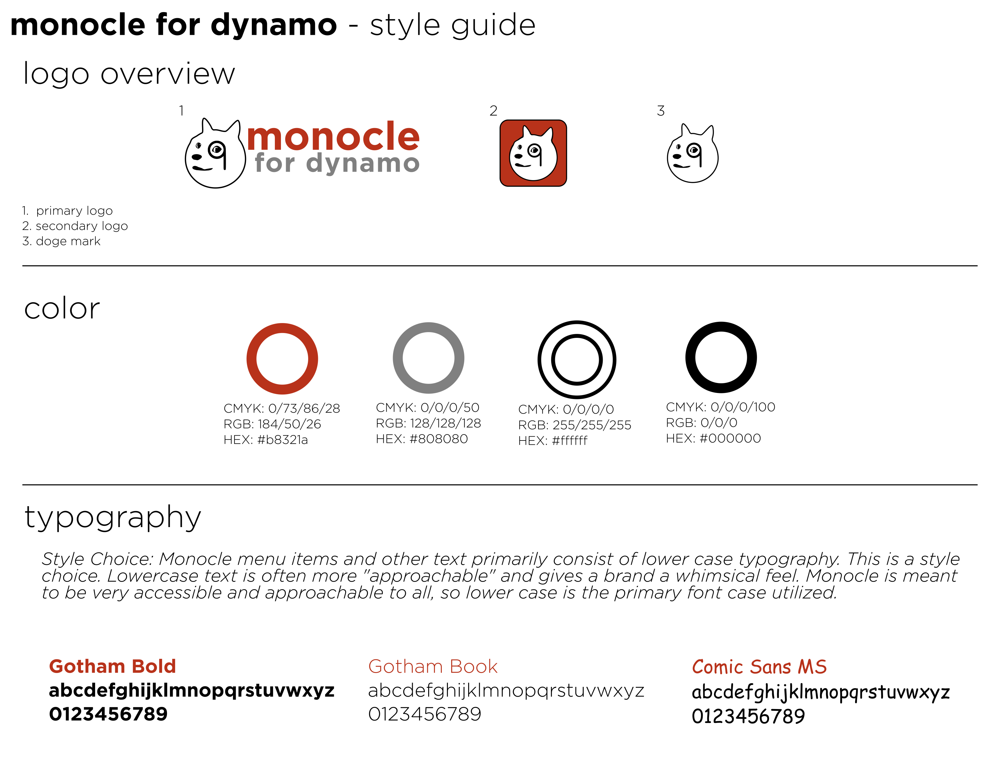

<h1 align="center">
  <br>
  
  <br>
</h1>

<h3 align="center">A view extension for <a href="http://dynamobim.org/" target="_blank">Dynamo</a>.</h4>


[](https://github.com/johnpierson/MonocleForDynamo/graphs/commit-activity)
[](https://github.com/johnpierson/MonocleForDynamo/blob/master/LICENSE)


If you appreciate the work put into this free package, please vote in support of it on Dynamo's package manager. 

## Disclaimer
This tool is not affiliated with Autodesk and was written and provided in a personal capacity by the author. This tool is provided "as is" without warranty of any kind, express or implied. Use at your own risk. By using this open-source tool, you acknowledge that the developers and contributors are not liable for any damages, losses, or issues that may arise from its use. You are responsible for ensuring compliance with all applicable laws and regulations. Remember, open-source software relies on community contributions, so functionality and security might vary. Always review, understand, and, if necessary, modify the code to suit your specific needs.

## LICENSE
This code is licensed primarily under [BSD 3-Clause](https://github.com/johnpierson/MonocleForDynamo/blob/master/LICENSE) with a [Commons Clause License](https://commonsclause.com/) attached to that.

## Current Version
The canonical project contains configurations for Dynamo 2.0 through 2.19 (`net48`), Dynamo 3.0 through 3.6 (`net8.0-windows`), Dynamo 3.7 (`net10.0-windows`), and Dynamo 4.0 through 4.3 (`net10.0-windows`). Each configuration compiles against the **lowest stable patch** of its Dynamo minor version (exact pins in `Monocle.csproj`), so it never depends on an API that only exists in a later patch. The Windows CI build matrix covers 2.0, 2.12, 2.19, 3.0, 3.6, 3.7, 4.1, 4.2, and 4.3. These are build targets; Dynamo/Revit host smoke tests are still required for each supported host version.

## Dependency isolation
Monocle shares a process with Dynamo, Revit and every other package/add-in, so `MonocleViewExtension.dll` has **no third-party runtime dependencies**: no embedded DLLs, no `AssemblyResolve` handler, no Xceed, HelixToolkit, SharpDX or Newtonsoft references. The 3D standard views drive Dynamo's own Helix viewport through reflection, and the FOCA color picker uses the system color dialog. `tools/AssemblyGuard.cs` enforces this in CI:

```powershell
dotnet run --file tools/AssemblyGuard.cs -- deploy
```

## How the package loads Monocle
The Dynamo package ships only the small `MonocleExtension.dll` loader. When Dynamo starts, the loader:

1. picks the closest published build for the running Dynamo (same major version, same or older minor),
2. downloads it once to `bin\<major.minor>\MonocleViewExtension.dll` and verifies it against `deploy/SHA256SUMS`,
3. points `extra\Monocle_ViewExtensionDefinition.xml` at that build.

One folder per Dynamo version means several Dynamo versions can share one package folder (custom or network package paths) without loading each other's build. After Dynamo starts, the loader checks `SHA256SUMS` in the background and stages a newer build, which is used from the next launch. Installs from before this layout keep using `bin\MonocleViewExtension.dll` for one session and switch over when Dynamo closes. Set `MONOCLE_DEPLOY_URL` to test against another copy of the `deploy` folder.

## Publishing builds
```bash
# build every configuration into deploy/<ver>/ (see the Configurations list in Monocle.csproj)
msbuild src/Monocle/Monocle.sln /p:Configuration="Release 4.3" /p:Platform="Any CPU" /p:EnableDeploymentCopy=true /t:Restore,Build
# then regenerate the manifest the loader verifies against, and commit both
cd deploy && sha256sum */MonocleViewExtension.dll | sort -t/ -k1,1V > SHA256SUMS
```
CI fails if `SHA256SUMS` doesn't match the committed builds exactly.

## Build and Validation
Build on Windows with the .NET 8 and .NET 10 SDKs, the .NET Framework 4.8 targeting pack, and MSBuild. Restore and build a configuration with:

```powershell
msbuild src/Monocle/Monocle.sln /p:Configuration="Release 4.1" /p:Platform="Any CPU" /p:EnableDeploymentCopy=false /t:Restore,Build
```

The pure regression checks can run independently of Dynamo:

```powershell
dotnet run --project tests/Monocle.RegressionTests/Monocle.RegressionTests.csproj --configuration Release
```

The canonical project does not stage build output into `deploy` unless explicitly requested. For intentional local packaging, pass `/p:EnableDeploymentCopy=true` to the MSBuild command.

## Known Issues
- When installing from the package manager for the first time, you may need to restart Dynamo.

## Contributors
This package is primarily managed by the author of http://designtechunraveled.com, and by [People Like You™](https://github.com/johnpierson/MonocleForDynamo/graphs/contributors).

## Updates
Since there is not currently an update notification process on Dynamo's package manager, I post notifications for updates on twitter.
[](https://twitter.com/johntpierson)

Additionally,  updates come through in the extension menu now!

## Help improve Monocle
If you're interested in contributing to Monocle, just submit a [pull request](https://github.com/johnpierson/MonocleForDynamo/pulls) or a [feature request](https://github.com/johnpierson/MonocleForDynamo/issues) .

If submitting a pull request, keep in mind the monocle style guide below.

## monocle style guide

 

## Installation
Monocle is available through Dynamo's built-in package manager. This provides the simplest installation for most users. If you are interested in manual install, there are some fabulous resources out there describing how to build your own Dynamo package.

## Thank you!

[](https://forthebadge.com)

[](https://forthebadge.com)

